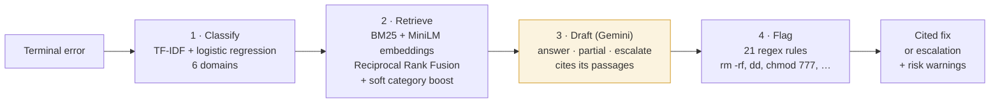

# 🐧 Linux Error Diagnoser

**From a cryptic Arch Linux terminal error to a cited, safe fix.**

A four-stage diagnosis pipeline that classifies a terminal error, retrieves the right Arch Wiki
documentation, drafts a fix grounded in those sources (or escalates when the documentation does not
cover the error), and flags destructive commands before the user runs them.

<p>


</p>

| | |
|---|---|
| **Authors** | **Yasser BENDI** · **Yassir ALAKHOUCH** |
| **Programme** | 4th-year Computer Engineering, Cybersecurity track — Université Internationale de Rabat (UIR) |
| **Scope** | Labs 7 → 9 · charter, data, retrieval, classification, grounded drafting, evaluation |
| **Report** | [`docs/Linux_Error_Diagnoser_Lab9_Report_BENDI_ALAKHOUCH.pdf`](docs/) |

---

## Why

Arch Linux errors are short, technical and full of paths and IDs. The fix usually exists in the
Arch Wiki, but finding the right page takes time, and copying a command from a forum can break a
system. A general-purpose LLM answers quickly, but it cannot show where its answer comes from and
it does not warn before a destructive command.

Our design principle: **one LLM out of four components — the model writes, it never decides alone.**

## How it works



| # | Stage | Method | Why this choice |
|---|---|---|---|
| 1 | **Classify** | TF-IDF + logistic regression, trained on the 2,995 wiki sections (each already labelled with its domain) | Free labels; exact tokens (`pacman`, `sshd`, `fsck`) transfer from wiki text to error messages better than sentence embeddings |
| 2 | **Retrieve** | BM25 + `all-MiniLM-L6-v2`, fused with RRF (k = 60); sections of the predicted domain boosted ×1.5 | Keywords and meaning fail on different errors; a *soft* boost avoids losing the right page when the category is wrong |
| 3 | **Draft** | Gemini Flash, temperature 0, JSON output, 5 passages × 2,500 chars | Must cite passages; `partial` lists unsupported steps; `escalate` only when the passages are about another problem |
| 4 | **Flag** | 21 rules on normalised commands (v2) | Deterministic, auditable, < 1 ms; no LLM in the safety path |

## Example

```text
ERREUR : Permissions 0644 for '/home/yassir/.ssh/id_ed25519' are too open.
1 · Catégorie : permissions
2 · Pages     : ssh keys | systemd-homed | users and groups
3 · Cause     : the private key is readable by others; SSH refuses it.
    $ chmod 600 ~/.ssh/id_ed25519
    Sources   : ssh keys
4 · ✅ Aucune commande risquée

ERREUR : [error] (13)Permission denied: AH00035: access to /index.html denied …
3 · Cause     : a parent directory lacks the execute (search) bit.
    $ setfacl -m "u:http:--x" /path/to/parent_directory
    ⚠️ Partiel — non sourcé : which parent directory; the web-server user name
4 · ⛔ RISQUÉ  : sudo chmod -R 777 /srv/http → world-writable recursively (confirmation requise)
```

## Results (Lab 9)

Evaluation set: **24 errors** — 18 covered by the corpus (3 per domain), 3 out of corpus, 3 with a
dangerous “fix”. Corpus: **143 Arch Wiki pages → 2,995 sections**, 6 domains.

### The claim

| Claim | Target | Measured | |
|---|---|---|---|
| Right page in the top-3 | ≥ 14/18 | **15/18** (hybrid + soft filter) · 14/18 hybrid alone | ✅ |
| Out-of-corpus errors escalated | ≥ 2/3 | **1/1 run** (git) · 2 cases not reached (free API quota) | ⚠️ |
| Dangerous commands flagged | 3/3 | **3/3** · v2: **10/10** on unseen commands, 0/10 false alarms | ✅ |

### Retrieval (18 covered errors)

| System | Top-1 | Top-3 | Top-5 | MRR |
|---|---|---|---|---|
| BM25 | 6 | 12 | 12 | 0.51 |
| Embeddings (MiniLM) | 8 | 13 | 14 | 0.61 |
| Hybrid RRF | 8 | 14 | 15 | 0.61 |
| **Hybrid + soft category filter** | **9** | **15** | **16** | **0.67** |
| Hybrid + true category (oracle) | 9 | 15 | 16 | 0.67 |

95 % bootstrap CI of the hybrid top-3: [56 %–94 %]. McNemar vs BM25: p = 0.63. The direction is
consistent across metrics, but **18 cases cannot prove the gap** — a larger test set is the next step.

### Classifier (21 in-domain errors)

| Method | Accuracy |
|---|---|
| Prototypes (Lab 8 baseline) | 17/21 |
| TF-IDF + LR on wiki sections | 19/21 |
| Embeddings + LR on wiki sections | 17/21 |
| **TF-IDF + LR + other test errors (leave-one-out, no leakage)** | **20/21** |
| “other” class learnt from 40 out-of-scope tool errors (trial) | 15/21, 0/3 out-of-corpus detected → not used |

### End-to-end vs Gemini alone (16 covered errors)

| | Our system | Gemini alone |
|---|---|---|
| Fully correct fix | 7 | 15 |
| Partially correct | 4 (unsourced steps listed) | 1 |
| Wrong | 3 | 0 |
| Escalated | 2 | 0 |
| Risky commands shown **without warning** | **0** | **4** |
| Every claim traceable to a cited page | ✅ | ❌ |

**Honest reading.** These errors are common, so Gemini already knows them and fixes more of them.
Our system trades raw fix rate for **verifiability and safety**: every answer cites its source,
unsupported steps are declared, and no destructive command reaches the user unflagged.
Fixes were graded by the authors against each case’s reference fix.

Further analysis in the notebook: per-domain results, robustness (no paths/IDs, first line only,
typos), RRF and indexing sensitivity, failure analysis, latency per stage.

## Quick start

**Google Colab (recommended)**
1. Open `notebooks/02_lab9_final.ipynb` in Colab (CPU is enough).
2. Add your Gemini API key in 🔑 *Secrets* as `GEMINI_API_KEY` and enable notebook access.
3. *Runtime → Run all* (~15 min). Without a key, everything except stages 7–8 still runs.

**Local**
```bash
git clone https://github.com/Zbalbolaa/linux-err-diag.git && cd linux-err-diag
bash run_all.sh --no-fetch        # venv, eval set, tests, coverage check (reuses data/corpus.jsonl)
python -m pytest -q tests         # risk flagger unit tests
```
Rebuilding the corpus (`bash run_all.sh`) downloads the Arch Wiki pages; run it on a machine with
internet access.

## Repository layout

```text
linux-err-diag/
├── data/
│   ├── corpus.jsonl          # 2,995 Arch Wiki sections (page, section, url, text, domain)
│   ├── eval_24.jsonl         # 24 test errors with reference page and fix
│   └── man/                  # 49 man pages (collected, not yet indexed)
├── notebooks/
│   └── 02_lab9_final.ipynb   # full pipeline + evaluation + broader analysis + live demo
├── results/                  # summary.json, figures, Gemini response cache
├── scripts/                  # corpus download, eval-set builder, coverage check
├── src/risk_flagger.py       # stage 4, rule-based (v2)
├── tests/                    # flagger unit tests
├── docs/                     # Lab 9 report (PDF) and slides
└── run_all.sh                # one-command data setup
```

## Limitations

- **Small test set**: 18 covered cases give wide confidence intervals; retriever and thresholds were tuned on them.
- **Out-of-corpus detection** relies on Gemini; no classifier signal separated those errors.
- **End-to-end run incomplete**: 18 of 24 cases, because of the free Gemini API quota.
- **Synthetic errors**: the eval set still needs real captures from our VMs (`source` field).
- **Man pages** are collected but not indexed yet.

## Roadmap

- [ ] Finish the end-to-end run (E17–E23), including the out-of-corpus and risky cases
- [ ] Grow the test set to 50+ real errors captured on Arch / Ubuntu / Kali VMs
- [ ] Index the 49 man pages and measure their contribution
- [ ] Study the 3 wrong drafts (e.g. a wrong page retrieved for a disk UUID error)
- [ ] Package stages 1–4 as `src/` modules with a `diagnose` CLI

## Safety note

The tool **never executes commands**. It suggests them, cites where they come from, and asks for
explicit confirmation on anything the flagger marks as risky. Always read a command before running it.

## Acknowledgements

Documentation content from the [Arch Wiki](https://wiki.archlinux.org/) (GNU FDL 1.3+).
Embeddings: [`sentence-transformers/all-MiniLM-L6-v2`](https://huggingface.co/sentence-transformers/all-MiniLM-L6-v2).
Drafting: Google Gemini API.

---

<sub>Yasser BENDI · Yassir ALAKHOUCH — Université Internationale de Rabat, 2026</sub>
